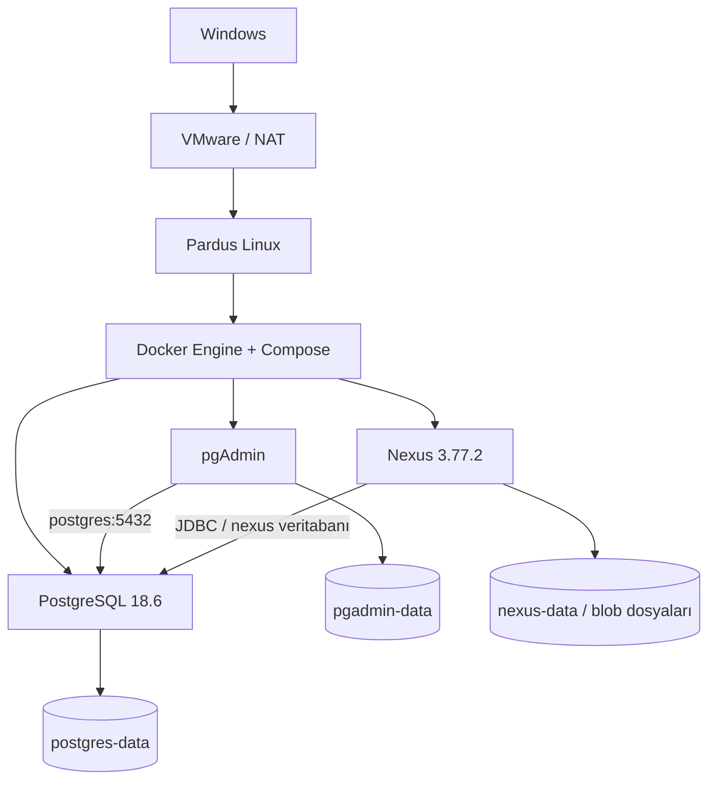

# Pardus üzerinde Docker, PostgreSQL, pgAdmin ve Nexus

Bu proje, VMware üzerinde Pardus kurulumu sonrasında ödevde istenen servisleri
tekrar kurulabilir Docker Compose dosyalarıyla hazırlar. Çalışan sistemin gerçek
test sonuçları `docs/DOGRULAMA.md` dosyasına kaydedilir; bir yapılandırma dosyasının
var olması, servisin kurulup test edildiği anlamına gelmez.

## Bileşenler

| Bileşen | İmaj / sürüm | Amaç |
|---|---|---|
| Pardus | 25.2 XFCE (mevcut sanal makine) | Linux çalışma ortamı |
| PostgreSQL | `postgres:18.6` | Ödev ve Nexus metadata veritabanları |
| pgAdmin | `dpage/pgadmin4:9.18` | Tarayıcıdan veritabanı yönetimi |
| Nexus | `sonatype/nexus3:3.77.2-java17-alpine` | Paket / artifact deposu |
| Nexus referansı | `sonatype/nexus3:3.72.0-java17-alpine` | Ayrı dosya ve veri alanıyla eski sürüm |



## Kurulum

Pardus'ta bu klasöre geçin. Yaklaşık 6 GB VM RAM'i ve en az 15 GB boş disk
alanı bir ders laboratuvarı için başlangıç noktasıdır; kurumsal kapasite önerisi
değildir. Nexus'un Java heap ayarları 1024 MB'dir; toplam süreç belleği bunun
üzerine çıkabilir. İki Nexus örneğini aynı anda çalıştırmak ek RAM tüketir.

```bash
sudo bash scripts/install-docker.sh
python3 scripts/prepare.py
bash scripts/start.sh
sudo bash scripts/verify.sh
```

Nexus ilk açılışını tamamladıktan sonra [Sonatype CE EULA](https://links.sonatype.com/products/nxrm/ce-eula)
incelenir. Kabul ediliyorsa aşağıdaki açık onaylı kurulum komutu çalıştırılır:

```bash
sudo python3 scripts/configure-nexus.py --accept-eula
```

Bu komut ilk admin parolasını yeniler, PostgreSQL ile aynı kullanıcı/parolaya
sahip bir yerel Nexus laboratuvar yöneticisi oluşturur ve `odev-raw` deposunda
örnek dosya yükleme/indirme testi yapar. Gerçek parolaları yalnızca Git'in
dışındaki `access.txt` ve `private/` alanına yazar. Kullanıcı ayrıca bu parolaları
sohbet mesajına veya GitHub'a kopyalamamalıdır.

`prepare.py` rastgele güçlü parolalar üretir. `.env` veya `access.txt` zaten
varsa eski parolaları değiştirmez. Gerçek giriş bilgileri yereldeki `access.txt`
dosyasındadır; bu dosya ve `.env` Git'e dahil edilmez.

## Erişim

Varsayılan servis portları yalnızca Pardus'un `127.0.0.1` adresinde dinler.
Pardus tarayıcısından:

- pgAdmin: `http://127.0.0.1:5050`
- Nexus 3.77.2: `http://127.0.0.1:8081`
- PostgreSQL: `127.0.0.1:5432`

Windows'tan erişmek için SSH port yönlendirmesi kullanılabilir:

```bash
ssh -N -L 5050:127.0.0.1:5050 -L 8081:127.0.0.1:8081 adem@PARDUS_IP
```

Bu komut açıkken Windows tarayıcısından da aynı localhost adresleri kullanılabilir.
Başka makinelere erişim açmak gerekiyorsa ağ ve erişim kuralları ayrıca değerlendirilmelidir.

Bu bilgisayardaki canlı kurulumda `.env` içindeki `BIND_IP`, Pardus'un VMware NAT
adresine ayarlandı; Windows'tan doğrudan erişim adresleri yerel `access.txt`
dosyasındadır. Depoya örnek `.env.example` eklenir; kişisel IP ve parolalar eklenmez.

pgAdmin arayüzünün e-posta/parolası, PostgreSQL hesabından ayrıdır. Önceden
kaydedilmiş sunucu `postgres:5432` adresini kullanır. Buradaki `postgres`, Docker
ağındaki servis adıdır; konteyner içindeki `localhost` başka bir konteyneri göstermez.

## PostgreSQL ve Nexus bağlantısı

- PostgreSQL ilk açılışında `odev` ve `nexus` veritabanları hazırlanır.
- Nexus JDBC adresi `jdbc:postgresql://postgres:5432/nexus` olur.
- Nexus bağlantısı PostgreSQL için tanımlanan kullanıcı/parolayı kullanır.
- `pg_trgm` uzantısı Nexus veritabanına eklenir.
- Nexus'un metadata kayıtları PostgreSQL'de, blob dosyaları `/nexus-data` alanında tutulur.
- İlk SQL betiği yalnızca boş PostgreSQL veri alanında çalışır. Mevcut volume'de
  `.env` parolasını değiştirmek PostgreSQL kullanıcısının parolasını değiştirmez.

Nexus 3.72 örneği, ödevdeki komuta uygun biçimde ayrı kalıcı alanla H2 kullanır.
Bu eski örneğin PostgreSQL kullandığı iddia edilmez. Eski sürümü çalıştırmak için:

```bash
sudo docker compose -f compose.3.72.yml up -d
sudo docker compose -f compose.3.72.yml logs --tail=100
# Kaynak tasarrufu için örnek incelemesi bitince:
sudo docker compose -f compose.3.72.yml stop
```

3.72 arayüzü Pardus'ta `http://127.0.0.1:8082` adresindedir. Daha yeni bir sürümün
veri alanı eski sürüme bağlanmaz. Bu dosya bir downgrade veya migration komutu değildir.

## Yönetim ve yedek

```bash
sudo docker compose ps
sudo docker compose logs --tail=100 nexus
sudo docker compose stop
sudo docker compose start
sudo bash scripts/backup.sh
```

Sadece bu laboratuvarda, kısa süreli servis kesintisini kabul ederek kalıcılığı
yeniden sınamak için `sudo bash scripts/test-persistence.sh` çalıştırılabilir.
Bu test üç ana konteyneri aynı volume'lerle yeniden oluşturur; volume silmez.

`stop` verileri korur. `down` konteynerleri/ağı kaldırır, named volume'leri varsayılan
olarak korur. **`down -v` kalıcı verileri siler; normal kullanımda çalıştırmayın.**
Volume bir yedek değildir. Yedek betiği uygulama veritabanını, Nexus metadata'sını
ve durdurulmuş Nexus'un veri alanını aynı yedek klasöründe toplar. Geri yükleme,
ayrı bir ortamda veritabanı ve blob dosyaları birlikte ele alınarak test edilmelidir.

## Güvenlik ve kapsam

Bu çalışma, ödevin belirttiği eski Nexus sürümlerini kullanan yerel bir laboratuvardır.
İnternete açık üretim kurulumu değildir. TLS, üretim yetkileri, izleme ve kapasite
planlaması bu ödevin dışındadır. Parolalar komut örneklerine veya GitHub'a yazılmaz.
Docker yönetimi `sudo` ile yapılır; kullanıcıya kalıcı Docker grup yetkisi verilmez.

## Kaynaklar

- [Docker'ın Debian kurulum belgesi](https://docs.docker.com/engine/install/debian/)
- [PostgreSQL resmi Docker imajı ve 18+ volume yolu](https://hub.docker.com/_/postgres)
- [pgAdmin konteyner yapılandırması](https://www.pgadmin.org/docs/pgadmin4/latest/container_deployment.html)
- [Sonatype resmi Docker imajı](https://hub.docker.com/r/sonatype/nexus3)
- [Nexus PostgreSQL bağlantı yapılandırması](https://help.sonatype.com/en/install-nexus-repository-with-a-postgresql-database.html)
- [Nexus 3.77 sürüm notları](https://help.sonatype.com/en/sonatype-nexus-repository-3-77-0-release-notes.html)
